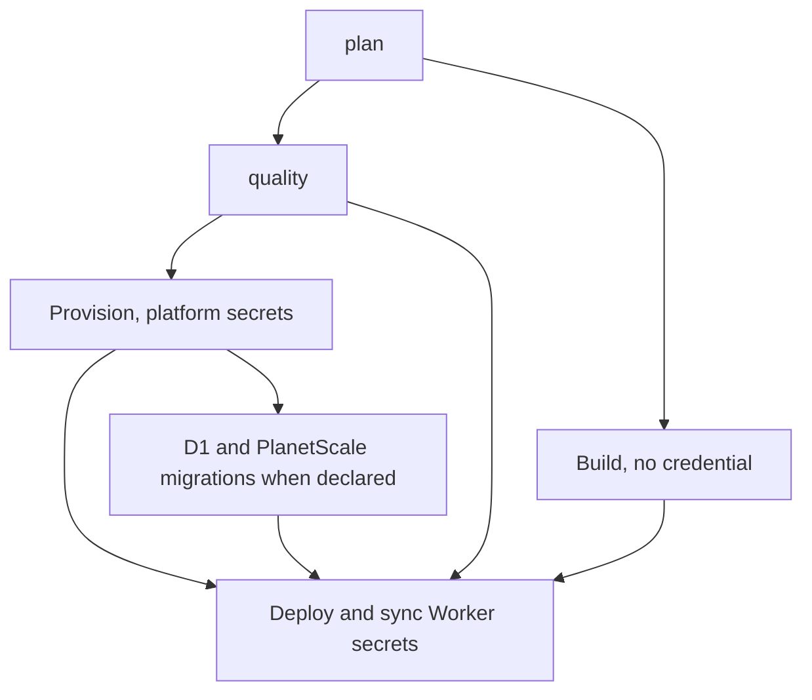

# GitHub Actions pipelines

Extends the reusable-workflow reference in `SKILL.md`. Read the current workflows under `NextNodeSolutions/core/.github/workflows/` and `.github/actions/setup/action.yml` before editing callers.

## Current entry points

| Workflow | Invocation | Purpose |
|---|---|---|
| `deploy.yml` | `workflow_call` | Deploy `app` or `static` projects to Workers |
| `plan-diff.yml` | `workflow_call` | Report Terraform changes on pull requests |
| `publish-package.yml` | `workflow_call`, core only | Publish core's own packages from main |
| `teardown.yml` | `workflow_dispatch` in core | Delete a selected project's deployed resources |
| `seed-vault.yml` | `workflow_dispatch` in core | Transitional one-shot copy of GitHub secrets into the vault |

## Deploy caller

Development conventionally runs on a push to main. Production is manually dispatched. Both call the same reusable workflow:

```yaml
name: Deploy development

on:
  push:
    branches: [main]

permissions:
  contents: read
  actions: read
  id-token: write

jobs:
  deploy:
    uses: NextNodeSolutions/core/.github/workflows/deploy.yml@main
    with:
      environment: development
```

The caller grants `id-token: write` so the called jobs can log in to the vault, and declares every permission so it keeps working if the organization default token becomes read-only. It passes no `secrets: inherit` and no `secrets:` block. A caller workflow with `secrets.<NAME>` is a leftover of the migration.

The inputs are `environment`, required as `development` or `production`, `config_file`, default `nextnode.toml`, and `dev_workflow_file`, default `deploy-dev.yml`. Match the latter to the caller's development workflow filename for production gating. Monorepo callers set `config_file` to their package's TOML and use path filters appropriate to its dependencies.

Deployable projects require a valid `PIPELINE_ENVIRONMENT`. Packages resolve to `none` without this variable.

## Deployment order



- `plan` emits quality tasks, `has_migrations`, `has_planetscale`, `package_dir` and `config_name`. `has_migrations` is true when D1 or PlanetScale is declared, including implied PlanetScale.
- `quality` runs lint, existing tests, optional D1 `check_command` and the production gate. Project scripts run without a core checkout. Only infrastructure tasks set the setup action's `infra` input.
- `build` installs the caller's dependencies and runs `pnpm build` at the workspace root, without `id-token: write` and without any secret. It uploads the package directory, minus `node_modules` and `.git`, as an artifact.
- `provision` loads platform secrets only, creates backing resources and applies Terraform. It never touches Worker secrets.
- `migrate` runs on every deployment with `has_migrations = true`. There is no git-diff migration detector. D1 runs before PlanetScale when both are declared. A PlanetScale migration installs the caller's dependencies and runs its migrate command, the one place caller code runs with vault access.
- `deploy` tolerates a skipped migration job, but not failed prerequisites. It downloads the build into the runner's temporary directory, outside the checkout, installs no caller dependency, loads platform and repository secrets, deploys each Worker and syncs its secrets. The Worker bundle must be self-contained.

Every job granted `id-token: write` runs core's CLI only, PlanetScale migration excepted. Never add a caller script, build or dependency install to such a job. The secret flow lives in [deploy-env.md](deploy-env.md).

Deployment is serialized by config path and environment with cancellation disabled. There is no Docker build, GHCR push or separate DNS job. SEO files are injected inside deployment before asset upload.

The quality matrix uses `[scripts].lint` and `[scripts].test`. A false value omits that task. With no tasks, plan emits a single skip task rather than an empty matrix. `project.filter` changes project task commands to filtered Turbo commands. It does not filter the workflow's unconditional root `pnpm build`.

## Production gate

`cli/pipeline/prod-gate.command.ts` fetches development workflow runs for the current commit and evaluates them through `domain/pipeline/prod-gate.ts`. A production quality matrix includes this task only when `environment.development` is enabled. Read the implementation before changing its allowed statuses or commit matching. Disabling the field removes the gate, it does not forbid development deploys.

## Pull-request infrastructure plan

A caller uses `NextNodeSolutions/core/.github/workflows/plan-diff.yml@main` with `environment` and optional `config_file`. It grants `contents: read`, `pull-requests: write` and `id-token: write`, with no `secrets: inherit`. Trigger on the project's TOML and affected deployment configuration. The job loads platform secrets only.

The CLI writes a PR comment when `PIPELINE_PR_NUMBER` is set, otherwise a step summary. Terraform detailed exit status distinguishes changes from failure. `plan-infra` does not apply the resource plan, but initializes HCP-backed Terraform state and can write a PR comment. Treat it as a CI infrastructure operation, not a local configuration validator.

## Publishing

`publish-package.yml` accepts `config_file`. Plan emits `publish = true` when the package table is present. The publish job additionally requires the `NextNodeSolutions/core` repository, main and successful quality jobs. Any other caller gets plan and quality, never publication: the release tooling is caller code running with vault access. It loads platform secrets, runs a filtered Turbo build, generates a GitHub App token and invokes semantic-release from `packages/<project.name>`.

Keep packages at that path when using this workflow. Its package-directory convention is not derived from `config_file`. Read [kickstart-package.md](kickstart-package.md) before adding a package caller.

Tag clearing runs only in the disposable publish runner. It is not an instruction for a developer checkout. `publish-result` runs even when publication fails and writes the resulting status.

## Teardown

Dispatch `teardown.yml` in core, where it loads platform secrets through the vault, with `repository`, `environment`, exact project-name `confirm`, optional `config_file` and `wipe_data` when required. Read [multi-service.md](multi-service.md) before dispatching. Teardown is destructive and separate from deployment.

The workflow's help text still names only D1 and R2. The code also guards KV. Use `domain/cloudflare/workers/teardown.ts` as the authority.
